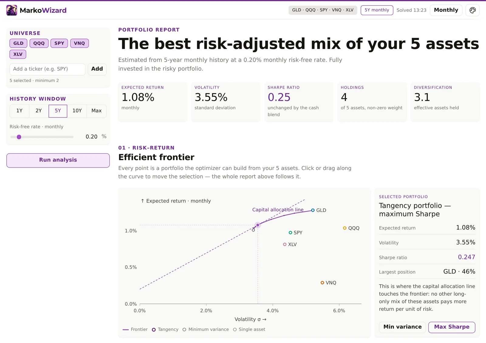
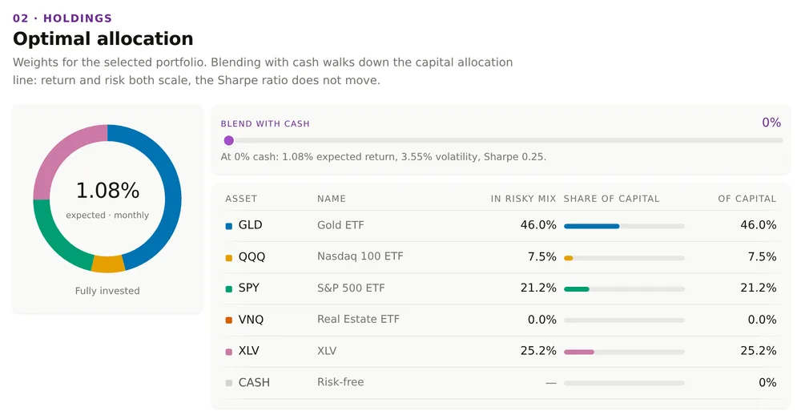
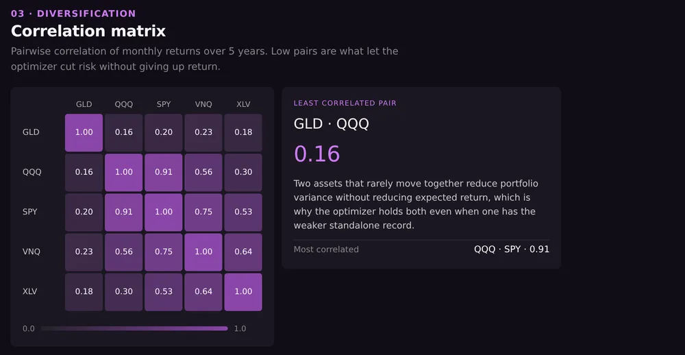

  <a href="assets/readme-banner.webp">

**A modern Python library for Markowitz portfolio optimization and analysis.**

MarkoWizard takes a list of assets, downloads their price history and finds the mix with the
best return for its risk: the efficient frontier, the maximum-Sharpe portfolio and the capital
allocation line, ready to plot. The math is plain NumPy and SciPy, and the frontier comes back as
a pandas DataFrame, so it fits into whatever analysis comes next.

The repository also ships a web app on top of the library: pick the assets and the history
window, and read the report in the browser. It runs from a small Docker image.

## Features

- **Markowitz mean-variance optimization**: the efficient frontier and the maximum-Sharpe
  portfolio, computed with `scipy.optimize`.
- **Capital allocation line**: mix the risky portfolio with a risk-free asset.
- **Charts**: Plotly figures for the efficient frontier, the allocation, the CAL, correlations
  and prices.
- **Market data**: helpers to download prices with yfinance and turn them into monthly returns.
- **Web app**: a FastAPI backend with an interactive report, in six color themes, each light
  and dark.

  
  
  

## Where to go next

- [Installation](installation.md): install the library or run the web app
- [Quick Start](quickstart.md): optimize a portfolio in a few lines of Python
- [Web Application](web-app.md): run the interactive report locally or with Docker
- [API Reference](reference/core.md): every public function and class
- [About](about.md): license, credits, contributing and the project's history

## Modules

| Module | Description |
|---|---|
| [`core`](reference/core.md) | `MarkowitzOptimizer`: efficient frontier optimization |
| [`allocation`](reference/allocation.md) | `CapitalAllocator`: risk-free asset allocation |
| [`visualization`](reference/visualization.md) | Plotly charts (efficient frontier, pie, CAL, correlation) |
| [`data`](reference/data.md) | Market-data fetching and monthly-return helpers (yfinance) |

The web app (`backend/`, `frontend/`) lives in the repository but is not part of the
installable package: see [Web Application](web-app.md).
